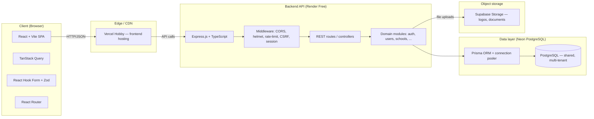

# EduTrack — Software Architecture

**Source of truth:** `EduTrack_MVP_and_Tech_Stack.md` (MVP scope, feature roadmap, tech stack)

This document derives the concrete system architecture from the product requirements. It is written for engineers implementing the MVP and for reviewers evaluating the design. Treat it as a living document; update it when the schema, module boundaries, or deployment topology change.

---

## 1. Architecture summary

| Decision | Rationale |
|---|---|
| **Project type** | Portfolio-grade multi-tenant web app, solo developer |
| **Architecture style** | Modular monolith (no microservices) |
| **Stack** | PERN: PostgreSQL (Neon), Express (Node.js), React (Vite), TypeScript |
| **Backend hosting** | Render Free (Express API) |
| **Frontend hosting** | Vercel Hobby (React SPA) |
| **Database** | Neon PostgreSQL free tier, dedicated project |
| **ORM** | Prisma |
| **Multi-tenancy** | Single shared database; `schoolId` on every tenant-owned record (not database-per-tenant) |
| **Authentication** | Secure cookie-based sessions, or access/refresh token design |
| **Password hashing** | Argon2id or bcrypt |
| **Validation** | Zod (frontend + backend) |
| **File storage** | Supabase Storage or equivalent free object storage |
| **Testing** | Vitest + Supertest (unit + API integration); Playwright later (E2E) |
| **CI** | GitHub Actions (lint, tests, build checks) |

---

## 2. High-level architecture diagram



### Data flow (typical request)

1. Browser sends an authenticated request (cookie `Authorization`) to `https://api.edutrack.example.com/api/v1/...`.
2. Render routes it to the Express service.
3. Middleware validates: CORS, helmet headers, rate limit, CSRF (cookie auth), then session/token → resolves `userId` + authorized `schoolId`.
4. Route handler calls the domain module with Zod-validated input.
5. Module enforces **tenant isolation**: every query is scoped by `schoolId` derived from the session — never trusted from the client.
6. Prisma issues parameterized SQL to Neon; results are returned as JSON.
7. File uploads stream directly to Supabase Storage (or via a signed URL), metadata stored in PostgreSQL.

---

## 3. Repository layout (modular monolith)

A single GitHub repository contains both frontend and backend, keeping deployments and schema in sync.

```
edu-track/
├── .github/
│   └── workflows/
│       ├── ci.yml              # lint + test + build on PR/push
│       └── deploy.yml          # optional: preview/deploy to Vercel + Render
├── prisma/
│   ├── schema.prisma           # single source of truth for data model
│   └── migrations/
├── server/                     # Express API (Node.js + TypeScript)
│   ├── src/
│   │   ├── config/             # env validation, prisma client, logger
│   │   ├── middleware/         # auth, tenant, csrf, rate-limit, error, validation
│   │   ├── modules/            # domain modules (one folder per bounded context)
│   │   │   ├── auth/
│   │   │   ├── users/
│   │   │   ├── schools/
│   │   │   ├── roles/
│   │   │   ├── academic-years/
│   │   │   ├── grade-levels/
│   │   │   ├── sections/
│   │   │   ├── subjects/
│   │   │   ├── teachers/
│   │   │   ├── students/
│   │   │   ├── enrollments/
│   │   │   ├── attendance/
│   │   │   ├── grading-periods/
│   │   │   ├── grades/
│   │   │   ├── report-cards/
│   │   │   ├── announcements/
│   │   │   ├── notifications/
│   │   │   └── audit-logs/
│   │   ├── utils/              # app-wide helpers (tenant scoping, responses, errors)
│   │   ├── app.ts              # Express app (middleware wiring)
│   │   └── server.ts           # HTTP server entry point
│   ├── tests/
│   │   ├── unit/
│   │   └── integration/        # Supertest API + tenant isolation tests
│   ├── package.json
│   └── tsconfig.json
├── web/                        # React frontend (Vite + TypeScript)
│   ├── src/
│   │   ├── components/         # shared UI (shadcn/ui + Tailwind)
│   │   ├── pages/              # route-level views
│   │   ├── hooks/              # TanStack Query API hooks
│   │   ├── lib/                # api client, zod schemas, utils
│   │   ├── routes/             # React Router config + role guards
│   │   └── main.tsx
│   ├── package.json
│   └── tsconfig.json
├── docs/
│   ├── ARCHITECTURE.md         # this document
│   ├── ERD.md                  # entity-relationship diagram
│   └── API.md                  # OpenAPI / endpoint reference
├── .env.example
├── .gitignore
├── docker-compose.yml          # optional local Postgres + dev tooling
├── package.json                # workspace root (optional)
├── tsconfig.json
└── README.md
```

### Module internal structure (example)

Each domain module under `server/src/modules/<name>/` follows the same shape so the codebase stays predictable for a solo developer:

```
modules/<name>/
├── routes.ts          # Express route definitions
├── controller.ts      # HTTP in/out (req/res), delegates to service
├── service.ts         # business logic + tenant scoping
├── schema.ts          # Zod validation schemas (input/output)
├── repository.ts      # Prisma queries (optional; can live in service)
├── index.ts           # public exports
└── __tests__/         # module unit tests
```

**Rule:** Modules never import routes or controllers from other modules. They may import shared utilities (`config`, `utils`, `prisma client`). Cross-module communication happens through well-defined service functions, not HTTP.

---

## 4. Data model (Prisma schema)

Multi-tenancy rule: every school-owned record carries `schoolId`. The backend derives the user's authorized school from the session; the client-supplied `schoolId` is never trusted. A unique `schoolId + <natural key>` constraint prevents duplicates within a school.

Below is the initial schema aligned to section 4.5 entities and the MVP phases.

```prisma
// prisma/schema.prisma
generator client {
  provider = "prisma-client-js"
}

datasource db {
  provider = "postgresql"
  url      = env("DATABASE_URL")
}

enum Role {
  PLATFORM_ADMIN
  SCHOOL_ADMIN
  TEACHER
  STUDENT
  PARENT
}

enum AttendanceStatus {
  PRESENT
  ABSENT
  LATE
  EXCUSED
}

enum EnrollmentStatus {
  ACTIVE
  TRANSFERRED
  GRADUATED
  INACTIVE
}

enum GradeState {
  DRAFT
  SUBMITTED
}

model School {
  id             String   @id @default(uuid())
  name           String
  address        String?
  contactEmail   String?
  contactPhone   String?
  logoUrl        String?        // Supabase Storage URL
  isActive       Boolean        @default(true)
  createdAt      DateTime       @default(now())
  updatedAt      DateTime       @updatedAt

  users          UserSchoolMembership[]
  academicYears  AcademicYear[]
  gradeLevels    GradeLevel[]
  sections       Section[]
  subjects       Subject[]
  teachers       TeacherProfile[]
  students       StudentProfile[]
  guardians      GuardianProfile[]
  announcements  Announcement[]
  auditLogs      AuditLog[]

  @@index([isActive])
}

model User {
  id            String   @id @default(uuid())
  email         String   @unique
  passwordHash  String
  firstName     String
  lastName      String
  isActive      Boolean  @default(true)
  emailVerified DateTime?
  createdAt     DateTime @default(now())
  updatedAt     DateTime @updatedAt

  memberships   UserSchoolMembership[]
  sessions      Session[]
  auditLogs     AuditLog[]

  @@index([email])
  @@index([isActive])
}

model Session {
  id           String   @id @default(uuid())
  userId       String
  tokenHash    String   @unique
  expiresAt    DateTime
  createdAt    DateTime @default(now())
  lastUsedAt   DateTime @default(now())

  user         User     @relation(fields: [userId], references: [id], onDelete: Cascade)

  @@index([userId])
  @@index([expiresAt])
}

model UserSchoolMembership {
  id        String   @id @default(uuid())
  userId    String
  schoolId  String
  role      Role     @default(TEACHER)
  isActive  Boolean  @default(true)
  createdAt DateTime @default(now())

  user      User     @relation(fields: [userId], references: [id], onDelete: Cascade)
  school    School   @relation(fields: [schoolId], references: [id], onDelete: Cascade)

  @@unique([userId, schoolId])
  @@index([schoolId])
  @@index([userId, isActive])
}

model AcademicYear {
  id          String   @id @default(uuid())
  schoolId    String
  name        String   // e.g. "School Year 2025-2026"
  startDate   DateTime
  endDate     DateTime
  isActive    Boolean  @default(false)
  createdAt   DateTime @default(now())

  school      School   @relation(fields: [schoolId], references: [id], onDelete: Cascade)
  gradeLevels GradeLevel[]
  enrollments Enrollment[]

  @@index([schoolId])
  @@index([schoolId, isActive])
}

model GradeLevel {
  id          String   @id @default(uuid())
  schoolId    String
  name        String   // e.g. "Grade 7", "Year 1"
  levelOrder  Int      @default(0)

  school      School   @relation(fields: [schoolId], references: [id], onDelete: Cascade)
  sections    Section[]

  @@index([schoolId])
  @@index([schoolId, levelOrder])
}

model Section {
  id          String   @id @default(uuid())
  schoolId    String
  gradeLevelId String
  name        String   // e.g. "7-A", "7-B"
  capacity    Int?

  school      School        @relation(fields: [schoolId], references: [id], onDelete: Cascade)
  gradeLevel  GradeLevel    @relation(fields: [gradeLevelId], references: [id], onDelete: Cascade)
  subjects    Subject[]
  assignments TeachingAssignment[]
  enrollments Enrollment[]
  attendance  AttendanceSession[]

  @@index([schoolId])
  @@index([schoolId, gradeLevelId])
  @@unique([schoolId, gradeLevelId, name])
}

model Subject {
  id          String   @id @default(uuid())
  schoolId    String
  name        String   // e.g. "Mathematics"
  code        String?  // e.g. "MATH101"
  description String?

  school      School        @relation(fields: [schoolId], references: [id], onDelete: Cascade)
  sections    Section[]
  assignments TeachingAssignment[]
  grades      Grade[]

  @@index([schoolId])
  @@unique([schoolId, code])
}

model TeacherProfile {
  id          String   @id @default(uuid())
  schoolId    String
  userId      String   @unique
  employeeId  String?  @unique
  phone       String?
  hireDate    DateTime?

  school      School   @relation(fields: [schoolId], references: [id], onDelete: Cascade)
  user        User     @relation(fields: [userId], references: [id], onDelete: Cascade)
  assignments TeachingAssignment[]

  @@index([schoolId])
  @@index([userId])
}

model StudentProfile {
  id          String   @id @default(uuid())
  schoolId    String
  userId      String   @unique?
  studentNumber String  @unique
  dateOfBirth DateTime?
  phone       String?

  school      School   @relation(fields: [schoolId], references: [id], onDelete: Cascade)
  user        User     @relation(fields: [userId], references: [id], onDelete: Cascade)
  guardians   StudentGuardian[]
  enrollments Enrollment[]
  attendance  AttendanceRecord[]
  grades      Grade[]

  @@index([schoolId])
  @@index([studentNumber])
}

model GuardianProfile {
  id          String   @id @default(uuid())
  schoolId    String
  userId      String   @unique
  phone       String?
  relationship String? // e.g. "Father", "Mother", "Guardian"

  school      School   @relation(fields: [schoolId], references: [id], onDelete: Cascade)
  user        User     @relation(fields: [userId], references: [id], onDelete: Cascade)
  links       StudentGuardian[]

  @@index([schoolId])
  @@index([userId])
}

model StudentGuardian {
  id            String @id @default(uuid())
  studentId     String
  guardianId    String
  isPrimary     Boolean @default(false)

  student       StudentProfile @relation(fields: [studentId], references: [id], onDelete: Cascade)
  guardian      GuardianProfile @relation(fields: [guardianId], references: [id], onDelete: Cascade)

  @@unique([studentId, guardianId])
}

model Enrollment {
  id            String          @id @default(uuid())
  schoolId      String
  studentId     String
  academicYearId String
  sectionId     String
  status        EnrollmentStatus @default(ACTIVE)
  enrolledAt    DateTime        @default(now())

  school        School          @relation(fields: [schoolId], references: [id], onDelete: Cascade)
  student       StudentProfile  @relation(fields: [studentId], references: [id], onDelete: Cascade)
  academicYear  AcademicYear    @relation(fields: [academicYearId], references: [id], onDelete: Cascade)
  section       Section         @relation(fields: [sectionId], references: [id], onDelete: Cascade)
  attendance    AttendanceRecord[]
  grades        Grade[]

  @@index([schoolId])
  @@index([schoolId, studentId])
  @@index([schoolId, academicYearId, sectionId])
  @@unique([schoolId, studentId, academicYearId]) // one active enrollment per student per year
}

model TeachingAssignment {
  id            String   @id @default(uuid())
  schoolId      String
  teacherId     String
  subjectId     String
  sectionId     String?
  academicYearId String

  school        School          @relation(fields: [schoolId], references: [id], onDelete: Cascade)
  teacher       TeacherProfile  @relation(fields: [teacherId], references: [id], onDelete: Cascade)
  subject       Subject         @relation(fields: [subjectId], references: [id], onDelete: Cascade)
  section       Section?        @relation(fields: [sectionId], references: [id], onDelete: SetNull)
  academicYear  AcademicYear    @relation(fields: [academicYearId], references: [id], onDelete: Cascade)

  @@index([schoolId])
  @@index([schoolId, teacherId])
  @@index([schoolId, sectionId])
}

model AttendanceSession {
  id          String   @id @default(uuid())
  schoolId    String
  sectionId   String
  date        DateTime // the class date
  recordedById String  // teacher who took attendance
  createdAt   DateTime @default(now())

  school      School       @relation(fields: [schoolId], references: [id], onDelete: Cascade)
  section     Section      @relation(fields: [sectionId], references: [id], onDelete: Cascade)
  recordedBy  TeacherProfile @relation(fields: [recordedById], references: [id])
  records     AttendanceRecord[]

  @@index([schoolId])
  @@index([schoolId, sectionId, date])
  @@unique([schoolId, sectionId, date]) // one session per class per day
}

model AttendanceRecord {
  id             String          @id @default(uuid())
  sessionId      String
  enrollmentId   String
  status         AttendanceStatus
  recordedAt     DateTime      @default(now())
  recordedById   String
  notes          String?

  session        AttendanceSession @relation(fields: [sessionId], references: [id], onDelete: Cascade)
  enrollment     Enrollment        @relation(fields: [enrollmentId], references: [id], onDelete: Cascade)
  recordedBy     TeacherProfile    @relation(fields: [recordedById], references: [id])

  @@index([sessionId])
  @@index([enrollmentId])
  @@unique([sessionId, enrollmentId]) // one record per student per session
}

model GradingPeriod {
  id          String   @id @default(uuid())
  schoolId    String
  name        String   // e.g. "Quarter 1", "Semester 1"
  startDate   DateTime
  endDate     DateTime
  isActive    Boolean  @default(false)

  school      School      @relation(fields: [schoolId], references: [id], onDelete: Cascade)
  grades      Grade[]

  @@index([schoolId])
  @@index([schoolId, isActive])
}

model Grade {
  id             String   @id @default(uuid())
  schoolId       String
  studentId      String
  subjectId      String
  gradingPeriodId String
  enrollmentId   String?  // links to enrollment for context
  value          Decimal  @db.Decimal // or Float depending on Neon/Prisma support
  maxValue       Decimal  @db.Decimal
  state          GradeState @default(DRAFT)
  submittedAt    DateTime?
  notes          String?

  school         School          @relation(fields: [schoolId], references: [id], onDelete: Cascade)
  student        StudentProfile  @relation(fields: [studentId], references: [id], onDelete: Cascade)
  subject        Subject         @relation(fields: [subjectId], references: [id], onDelete: Cascade)
  gradingPeriod  GradingPeriod   @relation(fields: [gradingPeriodId], references: [id], onDelete: Cascade)
  enrollment     Enrollment?     @relation(fields: [enrollmentId], references: [id], onDelete: SetNull)

  @@index([schoolId])
  @@index([schoolId, studentId])
  @@index([schoolId, subjectId, gradingPeriodId])
  @@unique([schoolId, studentId, subjectId, gradingPeriodId])
}

model Announcement {
  id          String   @id @default(uuid())
  schoolId    String
  title       String
  content     String
  sectionId   String?  // null = school-wide
  publishedAt DateTime @default(now())
  authorId    String   // staff who published

  school      School   @relation(fields: [schoolId], references: [id], onDelete: Cascade)
  section     Section? @relation(fields: [sectionId], references: [id], onDelete: SetNull)

  @@index([schoolId])
  @@index([schoolId, sectionId])
}

model Notification {
  id          String   @id @default(uuid())
  schoolId    String
  userId      String
  title       String
  content     String
  isRead      Boolean  @default(false)
  readAt      DateTime?
  createdAt   DateTime @default(now())

  school      School @relation(fields: [schoolId], references: [id], onDelete: Cascade)
  user        User   @relation(fields: [userId], references: [id], onDelete: Cascade)

  @@index([schoolId])
  @@index([schoolId, userId, isRead])
}

model AuditLog {
  id          String   @id @default(uuid())
  schoolId    String
  actorId     String?        // user who performed the action
  action      String         // e.g. "CREATE_STUDENT", "UPDATE_GRADE"
  entityType  String
  entityId    String
  changes     Json?          // before/after snapshot
  createdAt   DateTime @default(now())

  school      School   @relation(fields: [schoolId], references: [id], onDelete: Cascade)
  actor       User?    @relation(fields: [actorId], references: [id], onDelete: SetNull)

  @@index([schoolId])
  @@index([schoolId, entityType, entityId])
  @@index([schoolId, createdAt])
}
```

### Key schema design notes

- **`uuid()` primary keys** — opaque IDs prevent enumeration attacks (no sequential `/students/1` guessable URLs).
- **`schoolId` on every tenant-owned table** — enables tenant-scoped queries and RLS-style application-level isolation.
- **`@@unique` constraints** — prevent duplicate sections per grade, one attendance session per class per day, one grade per student per subject per period, one active enrollment per student per year.
- **`enrollment` as the join** — a student connects to an academic year *and* section through `Enrollment`, not a permanent field on `StudentProfile` (per the doc's guidance in 4.5).
- **`AuditLog.changes` as JSON** — flexible before/after snapshot for auditable changes (attendance corrections, grade changes, user deactivation).

---

## 5. Security & tenant isolation architecture

This is a foundational requirement per the doc, not an enhancement.

### 5.1 Authentication
- Cookie-based sessions (`HttpOnly`, `Secure`, `SameSite=Strict`) **or** access/refresh token pair stored in HttpOnly cookies.
- Session token hashed before storage (`tokenHash`); only the hash is compared.
- Sessions have `expiresAt` and `lastUsedAt`; expired sessions are pruned.
- Passwords hashed with Argon2id or bcrypt (never plaintext).
- Password reset via time-limited, single-use token.

### 5.2 Authorization (RBAC)
- Roles: `PLATFORM_ADMIN`, `SCHOOL_ADMIN`, `TEACHER`, `STUDENT`, `PARENT`.
- `UserSchoolMembership.role` defines the user's role *within a school*; a user can belong to multiple schools with different roles.
- Middleware resolves the authorized `schoolId` from the session + membership, then enforces role-based route/API access.
- Platform admin operates across schools; school admin/teacher/student/parent are scoped to one school.

### 5.3 Tenant isolation (enforced on the backend)
1. Derive `schoolId` from the authenticated session + `UserSchoolMembership` — **never** from `req.body`, `req.params`, or `req.query`.
2. Every repository query appends `WHERE schoolId = :authorizedSchoolId`.
3. Write operations verify the target record's `schoolId` matches the authorized school before mutating.
4. Tests must assert a user from School A cannot read/update/delete School B's records (read, create, update, delete).

### 5.4 Additional controls
- CSRF protection for cookie-based state-changing endpoints.
- Rate limiting on auth endpoints (login, password reset, registration).
- Input validation on every endpoint with Zod (body, params, query).
- File uploads: validate MIME type, size, and content; store outside the database (Supabase Storage); serve private records through signed URLs, not direct object links.
- No sensitive data in URLs or logs.

---

## 6. API design

REST over JSON, versioned under `/api/v1`.

### Response envelope (consistent)
```json
{
  "success": true,
  "data": { ... },
  "error": null,
  "meta": { "page": 1, "pageSize": 20, "total": 120 }
}
```
Error envelope:
```json
{
  "success": false,
  "data": null,
  "error": { "code": "VALIDATION_ERROR", "message": "...", "details": [...] },
  "meta": null
}
```

### Endpoint map (MVP 1–2 focus)

| Module | Endpoint | Auth | Roles |
|---|---|---|---|
| auth | `POST /api/v1/auth/register` | public | — |
| auth | `POST /api/v1/auth/login` | public | — |
| auth | `POST /api/v1/auth/logout` | session | any |
| auth | `POST /api/v1/auth/password-reset/request` | public | — |
| auth | `POST /api/v1/auth/password-reset/confirm` | public | — |
| schools | `GET /api/v1/schools/me` | session | school admin |
| schools | `PATCH /api/v1/schools/me` | session | school admin |
| users | `GET /api/v1/users` | session | school admin |
| users | `POST /api/v1/users` | session | school admin |
| users | `PATCH /api/v1/users/:id` | session | school admin |
| users | `DELETE /api/v1/users/:id` | session | school admin |
| academic-years | `GET|POST|PATCH|DELETE /api/v1/academic-years` | session | school admin |
| grade-levels | `GET|POST|PATCH|DELETE /api/v1/grade-levels` | session | school admin |
| sections | `GET|POST|PATCH|DELETE /api/v1/sections` | session | school admin |
| subjects | `GET|POST|PATCH|DELETE /api/v1/subjects` | session | school admin |
| teachers | `GET|POST|PATCH|DELETE /api/v1/teachers` | session | school admin |
| students | `GET|POST|PATCH|DELETE /api/v1/students` | session | school admin |
| enrollments | `GET|POST|PATCH|DELETE /api/v1/enrollments` | session | school admin |
| teaching-assignments | `GET|POST|DELETE /api/v1/teaching-assignments` | session | school admin |
| attendance | `POST /api/v1/attendance/sessions` | session | teacher |
| attendance | `GET /api/v1/attendance/sessions/:id/records` | session | teacher/admin |
| grades | `GET|POST|PATCH /api/v1/grades` | session | teacher |
| announcements | `GET|POST /api/v1/announcements` | session | school/teacher |

Platform-admin routes (school provisioning) live under `/api/v1/platform/...` and are gated to `PLATFORM_ADMIN`.

---

## 7. Frontend architecture

| Layer | Technology | Purpose |
|---|---|---|
| Build tool | Vite | Dev server + production build |
| Framework | React 18 + TypeScript | UI |
| Routing | React Router | Client-side navigation + role guards |
| Styling | Tailwind CSS | Responsive design system |
| UI components | shadcn/ui (optional) | Accessible primitives |
| Forms | React Hook Form + Zod | Form state + validation shared with backend schemas |
| Server state | TanStack Query | API caching, loading/error states, mutations |
| Date handling | date-fns | Formatting and calculations |

### Frontend structure
```
web/src/
├── main.tsx
├── App.tsx                 # Router + route guards
├── routes/                 # route configs (public / protected / role-guarded)
├── pages/                  # route-level views (Login, Dashboard, Students, ...)
├── components/             # shared UI (shadcn/ui + custom)
│   ├── ui/                 # shadcn primitives
│   └── layout/             # shell, sidebar, nav
├── hooks/                  # TanStack Query API hooks (useStudents, useAttendance, ...)
├── lib/                    # apiClient (axios/fetch), zod schemas, utils
├── stores/                 # lightweight state (auth session)
└── types/                  # shared TypeScript types (generated from Prisma or hand-written)
```

**Responsive first:** The web app must be usable on tablets and phones before considering a native mobile app (per development principles).

---

## 8. Deployment architecture

```
Developer
   │ git push
   ▼
GitHub ─────▶ GitHub Actions (CI: lint, test, build)
   │
   ├─────────────▶ Vercel Hobby ───▶ Frontend (web/)
   │
   └─────────────▶ Render Free ───▶ Backend API (server/)
                                         │
                                         ▼
                                   Neon PostgreSQL (shared DB)
                                         │
                                         ▼
                                   Supabase Storage (files)
```

### Environment variables
```
# server/.env
DATABASE_URL="postgresql://..."          # Neon (pooled connection string for serverless/Render)
SESSION_SECRET="..."
FRONTEND_URL="https://...vercel.app"
SUPABASE_URL="..."
SUPABASE_ANON_KEY="..."
SUPABASE_SERVICE_ROLE_KEY="..."        # server-side only
PORT=3001
NODE_ENV="production"

# web/.env
VITE_API_URL="https://...render.com/api/v1"
```

### Free-tier considerations
- Use a dedicated Neon project for EduTrack (do not share with other projects' tenant data).
- Render free web services sleep when inactive → cold starts acceptable for a portfolio demo.
- Neon free tier has compute/storage/network limits; keep backups independent of the host.
- `.env` files never committed; `.env.example` committed without secrets.
- Separate dev and production environment variables.

---

## 9. Testing strategy

| Layer | Tool | Scope |
|---|---|---|
| Unit | Vitest | Utilities, validation schemas, service logic |
| API integration | Supertest | Express routes, auth, tenant isolation, RBAC |
| E2E (later) | Playwright | Complete user workflows (enroll → attendance → grades → report card) |

**Critical test areas:**
- Authentication (login/logout/session expiry)
- Authorization (role-based route access)
- Tenant isolation (cross-school read/write attempts on all CRUD operations)
- Validation (malformed body/params/query rejected)
- Multi-step workflows (enrollment → attendance → grade submission)

---

## 10. MVP implementation roadmap (from the doc)

| Phase | Work | Focus |
|---|---|---|
| 0 | Requirements, wireframes, database planning | Schema design, this architecture |
| 1 | Shared foundation and deployment | Auth, users, schools, roles, tenant isolation, CI, deploy skeleton |
| 2 | School and academic structure | Academic years, grade levels, sections, subjects, teachers, students, enrollments |
| 3 | Attendance and grades | Attendance sessions/records, grading periods, grades, report cards |
| 4 | Dashboards, reports and testing | Role dashboards, announcements, notifications, E2E tests |
| 5 | Documentation, security review, portfolio polish | ERD, API docs, README, demo data, deployed demo |

**Scope-control rules (solo developer):**
- Finish complete user workflows before adding advanced features.
- No AI, payments, or native mobile apps in MVP 1.
- No microservices.
- A feature is not complete until authorization, validation, error states, and tests are included.

---

## 11. Immediate next steps

1. Create `server/` and `web/` scaffolding with TypeScript + ESLint + Prettier.
2. Initialize Prisma (`prisma init`) and write `schema.prisma` from section 4.
3. Set up Neon database + connection pooler; run first migration.
4. Implement `auth/` module (register, login, logout, password hash, session cookie).
5. Implement `schools/` + `users/` + `roles/` with tenant isolation middleware.
6. Write tenant-isolation tests before building academic modules.
7. Deploy the skeleton to Render + Vercel; then iterate through MVP 2–4.
